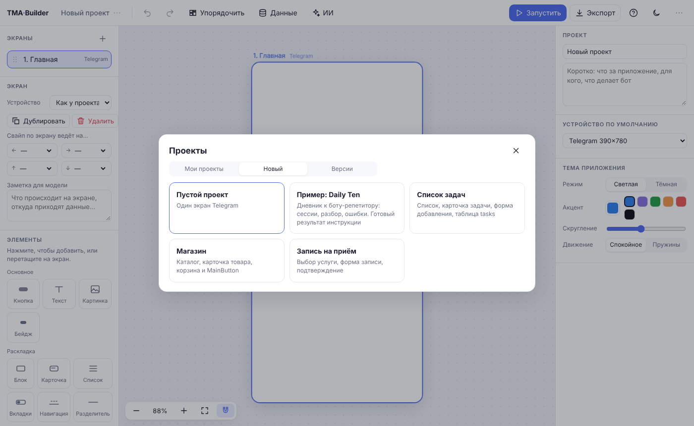
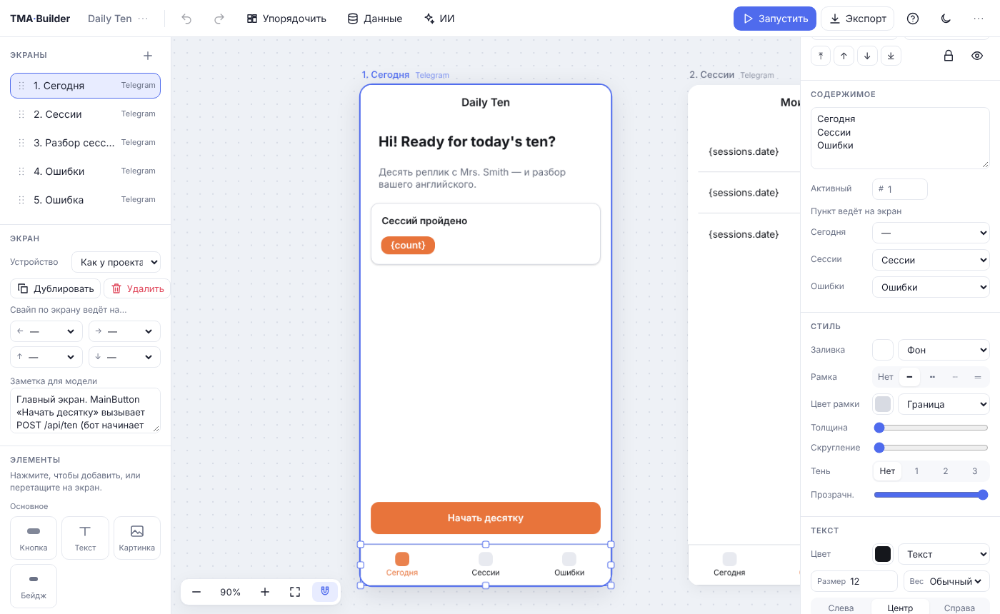
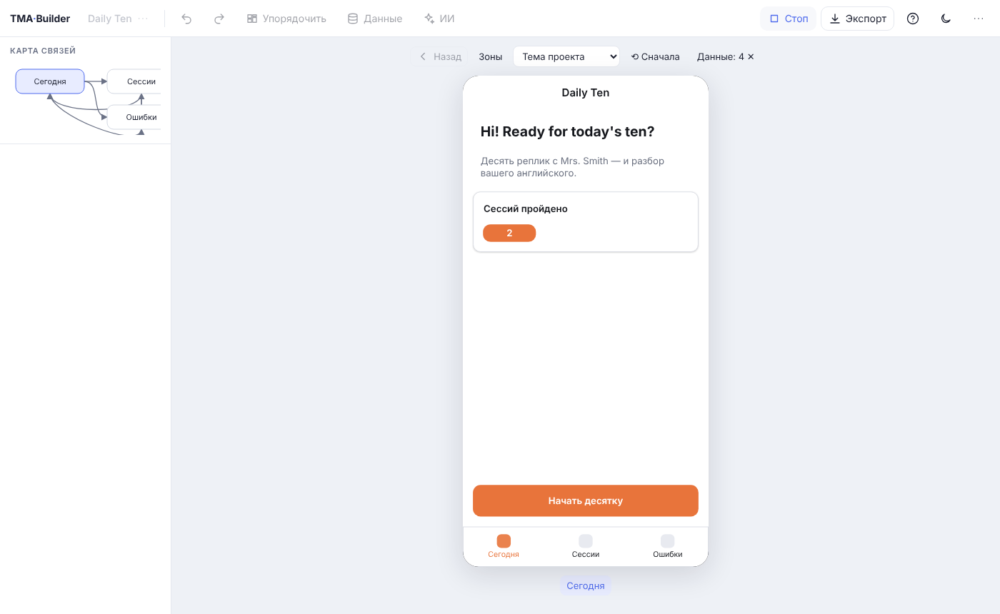
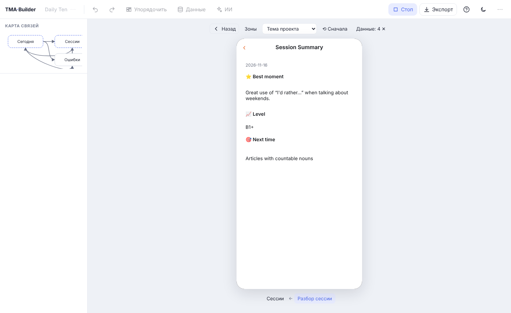

# Инструкция: мини-приложение к боту на примере Daily Ten

Эта инструкция проводит от пустого проекта до готовой папки для VS Code. Пример — мини-приложение к боту
[Daily Ten](https://github.com/inikonoff/Daily-Ten): каждый день бот ведёт разговор из десяти реплик с учительницей
Mrs. Smith и присылает Session Summary с разбором английского. Сам разговор остаётся в чате, а мини-приложение
становится **дневником прогресса**: сколько сессий пройдено, разбор каждой сессии и ошибки, которые стоит повторить.

Готовый результат можно открыть сразу: **название проекта вверху → «Новый» → «Пример: Daily Ten»**.
Инструкция объясняет, как собрать то же самое своими руками и что делать дальше с ботом.

## 1. Что такое мини-приложение и зачем оно боту

Telegram Mini App — это веб-страница, которая открывается внутри Telegram по кнопке бота. Бот хорош для разговора,
а мини-приложение — для того, что неудобно листать в чате: списки, карточки, история, настройки.

Для Daily Ten это значит: разговор и Summary приходят в чат, как и раньше, а в мини-приложении все прошлые сессии
и ошибки собраны в одном месте.

TMA Builder отвечает за первую половину работы: экраны, переходы, данные и проверку сценария — без кода.
Вторая половина — подключить приложение к боту и его базе — требует кода. Его удобнее всего писать вместе
с Claude Code: в разделе 10 объяснено, как устроено мини-приложение, а в разделе 11 — пошаговый план
с готовой задачей для Claude Code и проверками на каждом шаге.

## 2. Новый проект

Нажмите на название проекта в верхней панели и откройте вкладку **«Новый»**. Для своей работы выберите
«Пустой проект», для просмотра готового результата — «Пример: Daily Ten».



Справа в разделе **«Проект»** напишите название и пару фраз о приложении. Этот текст попадёт в описание
для нейросети при экспорте, поэтому пишите так, как объяснили бы задачу разработчику.

Там же выберите **устройство по умолчанию** — «Telegram 390×780» — и **тему приложения**. В примере светлая тема
с тёплым оранжевым акцентом `#e8743b`.

## 3. Экраны

В панели «Экраны» слева кнопкой **+** создайте пять экранов и переименуйте их двойным кликом:

1. **Сегодня** — главный экран: приветствие, сколько сессий пройдено, кнопка «Начать десятку».
2. **Сессии** — список прошлых сессий.
3. **Разбор сессии** — Session Summary выбранной сессии.
4. **Ошибки** — что стоит повторить.
5. **Ошибка** — объяснение одной ошибки.

Порядок меняется перетаскиванием за точки слева. В поле **«Заметка для модели»** под списком кратко опишите, что
происходит на экране, — это тоже уйдёт нейросети.


Управление холстом: **колесо мыши** — масштаб, **правая кнопка** — двигать холст, **Shift+1** — показать все экраны.

## 4. Главный экран

Элементы добавляются из палитры слева: **клик** ставит элемент под последним на активном экране,
**перетаскивание** — точно в нужное место.

На экран «Сегодня» добавьте:

- **Шапку** (раздел Telegram) — она сама встанет наверх во всю ширину. Текст: «Daily Ten».
- Два **текста**: крупный «Hi! Ready for today's ten?» и пояснение под ним.
- **Карточку** «Сессий пройдено» и **бейдж** — в нём будет число сессий (раздел 6). Клик по бейджу в палитре
  поставит его *под* карточкой; чтобы он оказался внутри, **перетащите** его из палитры прямо на карточку или
  потом сдвиньте мышью — карточка подсветит направляющими свои края.
- **MainButton** «Начать десятку» — главную кнопку Telegram. Она встанет внизу экрана.
- **Навигацию** — нижнее меню из трёх пунктов: «Сегодня», «Сессии», «Ошибки».

Текст любой кнопки или надписи правится **двойным кликом прямо на холсте**: Enter — сохранить, Esc — отменить.


Элементы двигаются мышью и сами притягиваются к краям и центрам соседей (розовые направляющие). Ctrl при
перетаскивании отключает привязку. **«Упорядочить»** в верхней панели выравнивает экран по правилам: шапка
наверху, ровные отступы, навигация внизу. Повторное нажатие отменяет.

> MainButton в Telegram — нативная кнопка внизу окна. В Daily Ten она должна начать новую десятку: бот присылает
> в чат первую реплику, а мини-приложение закрывается. Запишите это в заметке экрана — модель увидит при экспорте.

## 5. Данные и бот

Откройте **«Данные»** в верхней панели. На вкладке **«Таблицы»** создайте две таблицы — это то, что мини-приложение
будет получать от бота:

| Таблица | Поля |
|---|---|
| `sessions` | `date` (дата, обязательное), `best_moment`, `level_cefr`, `focus` (текст) |
| `mistakes` | `was`, `correct` (текст, обязательные), `why`, `category` (текст) |

У каждой записи автоматически есть `id`, `user_id` (кто из Telegram её создал) и `created_at`.


На вкладке **«Тестовые записи»** заведите пару сессий и ошибок. Они нужны, чтобы проверить сценарий в режиме
«Запустить», и в проект не попадают: в настоящем приложении данные придут из базы бота.


На вкладке **«Бот»** перечислите команды бота. У Daily Ten это `/ten`, `/summary`, `/finish` и `/start`.
Токен бота здесь не вводится и в проект не попадает.


## 6. Список → разбор сессии

Это главный приём мини-приложений: список записей, а нажатие на строку открывает подробности.

**Экран «Сессии».** Добавьте **список**, выделите его и в инспекторе справа:

1. В разделе **«Данные»** выберите таблицу `sessions`, режим **«Список записей»**, поле `date` — в строках будут даты.
2. В разделе **«Действие по нажатию»** выберите **«Перейти на экран» → «Разбор сессии»**.

Подсказка под настройками подтверждает: *нажатие на строку откроет экран и передаст ему выбранную запись*.
На холсте привязанные значения выглядят как `{sessions.date}` — так видно, откуда они придут.


**Экран «Разбор сессии».** Добавьте шапку «Session Summary», кнопку **BackButton** (действие «Назад»), подписи
«⭐ Best moment», «📈 Level», «🎯 Next time» и под каждой — текст с привязкой **«Поле выбранной записи»**:
таблица `sessions` и поля `best_moment`, `level_cefr`, `focus`.


Экраны **«Ошибки»** и **«Ошибка»** собираются так же: список по таблице `mistakes` (поле `was`) с переходом на
«Ошибка», а там тексты с полями `was`, `correct`, `why`.

Бейдж на главном экране привяжите к `sessions` в режиме **«Одно значение»** без поля — он покажет число записей
(на холсте в нём будет подсказка `{count}`).

## 7. Нижнее меню

Выделите **навигацию** на экране «Сегодня». В разделе «Содержимое» у каждого пункта есть выбор экрана:
«Сессии» → экран «Сессии», «Ошибки» → экран «Ошибки». Пункт «Сегодня» оставьте без перехода — вы и так на нём.
Число в поле **«Активный»** — какой пункт подсвечен.



Скопируйте навигацию на экраны «Сессии» и «Ошибки»:

1. выделите навигацию и нажмите **Ctrl+C**;
2. **щёлкните по пустому месту экрана**, куда нужно вставить, — так он станет активным (обведён синим);
3. нажмите **Ctrl+V** — копия встанет на то же место внизу;
4. в инспекторе поменяйте «Активный» и переходы пунктов.

Если пропустить шаг 2, копия окажется на том же экране поверх оригинала — Ctrl+Z её уберёт. Пункты меню **заменяют** текущий экран, а не копятся в истории «Назад» — как в настоящих
приложениях.

Слева внизу **«Карта связей»** рисует все переходы стрелками. Удобно проверять, что ни один экран не остался
без входа.

## 8. Запустить

Нажмите **«Запустить»** (или клавишу P). Экран устройства встанет по центру, и приложение можно пройти как настоящее:

- нижнее меню переключает разделы;
- нажатие на сессию в списке открывает её разбор с данными этой сессии;
- «‹» в шапке и кнопка «Назад» над экраном возвращают обратно, переход проигрывается в обратную сторону;
- **«Зоны»** подсвечивают всё, что можно нажать; клик мимо подсвечивает зоны на полсекунды;
- список **«Тема проекта / Telegram светлая / Telegram тёмная»** показывает экраны в цветах Telegram.





Если что-то не так, нажмите «Стоп», поправьте и запустите снова. Отменить можно что угодно: Ctrl+Z.

Перед большими правками сохраните версию: **название проекта → «Версии» → «Сохранить версию»**. К ней можно
вернуться в любой момент.

## 9. Экспорт

Нажмите **«Экспорт»**. Отметьте:

- **Скриншоты экранов** — модель увидит, как задумано визуально;
- **Заготовка приложения** — если хотите готовый код фронтенда. База — **Postgres**: у Daily Ten Supabase.

Затем **«Записать в папку…»** (Chrome и Edge) или **«Скачать ZIP»**. Если указать путь к папке, после записи
появится ссылка «Открыть в VS Code».


В папке будут:

| Файл | Что это |
|---|---|
| `PROMPT.md` | Экраны, элементы, переходы, данные и тема словами — для модели |
| `AGENTS.md`, `CLAUDE.md` | Правила работы для Claude Code и других агентов |
| `project.json` | Исходный макет; открывается обратно в TMA Builder |
| `screens/*.png` | Скриншоты экранов |
| `app/` | Фронтенд: Vite + React + TypeScript + Telegram WebApp SDK. Адрес API задаётся в `app/.env` (`VITE_API_URL`) |
| `server/` | Бот и API на TypeScript — универсальная заготовка, для Daily Ten не нужна (см. ниже) |

## 10. Как устроена Telegram Mini App

Прочитайте этот раздел до того, как браться за подключение. Здесь пять понятий, без которых дальше легко
заблудиться.

**1. Мини-приложение — обычная веб-страница.** HTML, CSS, JavaScript, как любой сайт. Её можно открыть
и в браузере — она покажется, но без данных пользователя (см. пункт 3). Telegram просто показывает эту страницу
у себя во встроенном окне.

**2. Страница должна жить по HTTPS.** Telegram открывает только адреса `https://…`. Для постоянной публикации
подойдёт GitHub Pages (бесплатно). Для проверки с компьютера — **туннель**: программа вроде `cloudflared` даёт
временный адрес `https://что-то.trycloudflare.com`, который ведёт на страницу, запущенную у вас локально.

**3. Открывать надо кнопкой бота, а не ссылкой.** Есть три способа: **кнопка меню** слева от поля ввода,
**кнопка WebApp** под сообщением бота и прямая ссылка `t.me/<бот>/<приложение>`. Только при таком открытии
Telegram передаёт странице **`initData`** — строку с данными пользователя (id, имя) и **подписью**.
Обычная ссылка на страницу откроется в браузере, и `initData` там не будет.

**4. `initData` — пропуск, который проверяет сервер.** Страница отправляет `initData` вместе с каждым запросом
к API бота. Сервер проверяет подпись своим токеном бота: если подпись верная, это действительно пользователь
с этим id, и ему можно отдать *его* сессии. Без проверки кто угодно мог бы подставить чужой id. Токен бота при этом
есть только на сервере — на странице его не бывает никогда.

**5. Страница и API — на разных адресах.** Страница на GitHub Pages (`https://вы.github.io/…`), API — в самом боте
на Render (`https://ваш-бот.onrender.com/api/…`). Браузер по умолчанию запрещает такие запросы между разными
сайтами. Сервер должен явно разрешить их для адреса вашей страницы — это настройка **CORS**.

Всё вместе:

```text
Пользователь нажимает кнопку меню в боте
  → Telegram открывает https://вы.github.io/daily-ten-app/  (страница с GitHub Pages)
  → страница запрашивает https://ваш-бот.onrender.com/api/sessions, прикладывая initData
  → бот проверяет подпись, берёт из Supabase сессии этого пользователя и отдаёт JSON
  → страница показывает список
```

## 11. Подключение к боту Daily Ten — по шагам

У Daily Ten уже есть бот на Python (aiogram), база на Supabase и HTTP-сервер для проверки здоровья
(`src/health_server.py`, aiohttp). Поэтому `server/` из заготовки не нужен: API добавляется в этот сервер,
а из экспорта берётся только фронтенд `app/`.

Код пишет Claude Code, ваша задача — дать ему задачу, запустить и проверить. Каждый шаг заканчивается
**проверкой**: не идите дальше, пока она не прошла.

### Шаг 1. Тестовый бот

Не экспериментируйте на боте, которым пользуются люди. В [@BotFather](https://t.me/BotFather) отправьте `/newbot`,
придумайте имя — получите **токен тестового бота**. Запускайте с ним бота локально, как описано в README Daily-Ten
(Postgres в Docker, свой `.env`; ключи Groq нужны и для теста — без них бот не стартует).

**Проверка:** тестовый бот отвечает на `/start` в Telegram.

### Шаг 2. Страница открывается в браузере

Распакуйте экспорт, затем в терминале:

```bash
cd app
npm install
npm run dev
```

Откройте адрес, который покажет команда (обычно http://localhost:5173).

**Проверка:** видны экраны «Сегодня», «Сессии», «Ошибки», нижнее меню переключает их. Списки пустые или с ошибкой —
это нормально: API ещё нет, а в браузере нет `initData`.

### Шаг 3. Задача для Claude Code

Откройте в VS Code папку, где лежат рядом репозиторий `Daily-Ten` и папка экспорта, запустите Claude Code
и вставьте задачу целиком — она самодостаточна, ничего дописывать не нужно:

```text
Рядом лежат две папки: Daily-Ten (бот на Python/aiogram, Postgres на Supabase) и экспорт TMA Builder
(мини-приложение: AGENTS.md, PROMPT.md, project.json, screens/*.png, фронтенд app/ на Vite + React).
Прочитай AGENTS.md и PROMPT.md, посмотри скриншоты. Подключи мини-приложение к боту.

1. API в src/health_server.py (aiohttp, тот же порт PORT). Все ответы — JSON с именами полей как в project.json:
   GET  /api/sessions        → [{id, date, best_moment, level_cefr, focus}], только status = 'completed',
                                новые сверху, только записи пользователя из initData
   GET  /api/sessions/{id}   → одна сессия в том же виде (чужая сессия → 404)
   GET  /api/mistakes        → [{id, was, correct, why, category}] из всех завершённых сессий пользователя
   POST /api/ten             → начать новую десятку, как команда /ten: те же проверки (не чаще раза в сутки
                                по Минску, онбординг пройден), бот присылает в чат первую реплику.
                                Вынеси общую логику из _request_ten в функцию, не зависящую от Message.
   Соответствие полей:
     date        ← sessions.started_date (YYYY-MM-DD)
     best_moment ← user_summary.best_moment
     level_cefr  ← user_summary.level_cefr
     focus       ← user_summary.focus (список строк, склеить через "; ")
     mistakes    ← user_summary.mistakes[] (was, correct, why); id = "<session_id>-<номер>";
                   category — из error_logs той же сессии, если найдётся, иначе null
   user_summary хранится JSON-строкой — разбирай аккуратно, битые записи пропускай.

2. Безопасность.
   - Каждый /api-запрос проверяет заголовок X-Telegram-Init-Data: HMAC-SHA256 по алгоритму Telegram
     (секрет = HMAC("WebAppData", TELEGRAM_BOT_TOKEN)), auth_date не старше 24 часов. Иначе 401.
   - DEV_NO_AUTH=1 в .env пускает без initData как пользователя из DEV_USER_ID — только для локальной проверки,
     в проде переменной быть не должно.
   - CORS: разрешить только origin из WEBAPP_URL (без пути), методы GET/POST, заголовки Content-Type
     и X-Telegram-Init-Data. Новая переменная WEBAPP_URL в config.py и .env.example.

3. Кнопки бота. Если WEBAPP_URL задан:
   - в src/bot_menu.py кнопка меню — MenuButtonWebApp(text="Daily Ten", web_app=WebAppInfo(url=WEBAPP_URL))
     вместо MenuButtonCommands (иначе бот при каждом старте затирает кнопку приложения);
   - в ответе на /start — инлайн-кнопка «📒 Мой прогресс» с web_app=WebAppInfo(url=WEBAPP_URL).

4. Фронтенд app/:
   - адрес API берётся из VITE_API_URL (уже поддержано в app/src/api.ts);
   - MainButton «Начать десятку» вызывает POST /api/ten и затем Telegram.WebApp.close();
   - GitHub Actions: сборка app/ с VITE_API_URL из переменной репозитория и публикация на GitHub Pages
     (в vite.config.ts уже base: "./").

5. Тесты pytest: проверка initData (верная подпись, чужой токен, подделка, просроченная), эндпоинты на тестовой БД
   (свои записи видны, чужие — нет, без initData — 401). Обнови README (раздел «Мини-приложение») и .env.example.
Работай небольшими шагами, после каждого прогоняй тесты.
```

**Проверка:** Claude Code закончил, тесты бота проходят (`pytest`), в README появился раздел про мини-приложение.

### Шаг 4. API отвечает

Запустите тестового бота локально с `DEV_NO_AUTH=1` и `DEV_USER_ID=<ваш Telegram id>` (свой id подскажет
[@userinfobot](https://t.me/userinfobot)). Пройдите с ботом одну-две десятки, чтобы появились сессии, и откройте
в браузере http://localhost:10000/api/sessions.

**Проверка:** JSON со списком ваших сессий. Затем уберите `DEV_NO_AUTH`, перезапустите — тот же адрес должен
отвечать **401**. Это значит, что защита работает.

### Шаг 5. Проверка в Telegram через туннель

Бот запущен локально (порт 10000), API включено. Во втором терминале запустите страницу так, чтобы её запросы
к `/api` уходили на бота:

```bash
cd app
API_PROXY=http://localhost:10000 npm run dev
```

В третьем — туннель ([установка cloudflared](https://developers.cloudflare.com/cloudflare-one/connections/connect-networks/downloads/)):

```bash
cloudflared tunnel --url http://localhost:5173
```

Он напечатает адрес вида `https://word-word-word.trycloudflare.com`. Впишите его в `.env` бота как `WEBAPP_URL`,
`VITE_API_URL` оставьте пустым (запросы пойдут через тот же туннель) и перезапустите бота.

**Проверка:** в Telegram у тестового бота слева от поля ввода кнопка «Daily Ten» → открывается мини-приложение
→ в «Сессиях» ваши сессии → нажатие открывает разбор. «Начать десятку» закрывает приложение, и бот пишет первую реплику.

> Чтобы видеть ошибки страницы внутри Telegram Desktop, включите **Настройки → Продвинутые → Экспериментальные
> настройки → Enable webview inspecting**, затем правый клик по мини-приложению → **Inspect**.

### Шаг 6. Публикация

1. Создайте на GitHub репозиторий для страницы (например, `daily-ten-app`) и положите туда `app/` — или оставьте
   в репозитории бота, если Claude Code настроил сборку там.
2. В репозитории: **Settings → Pages → Source: GitHub Actions**; **Settings → Secrets and variables → Actions →
   Variables** → `VITE_API_URL` = адрес бота на Render, например `https://daily-ten.onrender.com`.
3. После публикации страница доступна по адресу `https://<вы>.github.io/daily-ten-app/`.
4. На Render в Environment бота добавьте `WEBAPP_URL` = этот адрес. `DEV_NO_AUTH` там быть **не должно**.
5. Перезапустите сервис.

**Проверка:**
- в браузере `https://<вы>.github.io/daily-ten-app/` показывает экраны (данные — нет, это нормально);
- `https://<бот>.onrender.com/api/sessions` в браузере отвечает **401**;
- в Telegram у **боевого** бота кнопка меню открывает приложение с вашими сессиями.

## 12. Если что-то не работает

| Что видно | Почему так бывает | Что сделать |
|---|---|---|
| Белый экран в Telegram | Страница не загрузила скрипты (неверный путь) или упала с ошибкой | Откройте адрес в браузере и посмотрите консоль (F12). В Telegram Desktop — Inspect (шаг 5). Проверьте, что в `vite.config.ts` стоит `base: "./"` |
| Экраны есть, списки пустые, ошибка 401 | Нет `initData`: страница открыта ссылкой или в браузере; либо страница и бот — разные боты (тестовый и боевой токены) | Открывайте только кнопкой меню или WebApp-кнопкой того же бота, чей токен у сервера |
| 401 у всех и всегда | Неверный `TELEGRAM_BOT_TOKEN` на сервере или ошибка в проверке подписи | Прогоните тесты на `initData` из шага 3; сверьте токен |
| В консоли `CORS` или `Failed to fetch` | `WEBAPP_URL` на сервере не совпадает с адресом страницы; `http` вместо `https`; Render спит | Сравните origin (схема + домен) страницы и `WEBAPP_URL`; адрес API — только `https://`; откройте `/health` бота, чтобы разбудить |
| Кнопка меню снова «Menu» с командами | `bot_menu.py` при старте ставит `MenuButtonCommands` | Пункт 3 задачи: при заданном `WEBAPP_URL` — `MenuButtonWebApp` |
| Туннель: `Blocked request` или 403 | Vite не пускает незнакомый адрес | Используйте cloudflared или ngrok — их адреса уже разрешены в `vite.config.ts` |
| Списки пустые, ошибок нет | У пользователя нет завершённых сессий | Пройдите с ботом десятку до Summary |
| Изменения не видны | Кэш Telegram или ещё идёт сборка Pages | Подождите 1–2 минуты после пуша, закройте и снова откройте приложение |

## 13. Полезное

- **Кнопка «?»** в верхней панели снова запускает обучение по интерфейсу.
- **Меню «⋯»** — новый проект, открыть или сохранить JSON, версии, язык (русский / английский), горячие клавиши.
- **ИИ** в верхней панели собирает черновик экрана по описанию («список уроков с прогрессом»), предлагает схему данных
  и переписывает тексты. Результат — черновик: «Оставить» или «Отменить». Нужен ключ Groq.
- **Ссылка** в окне экспорта упаковывает проект в адрес — удобно отправить себе на другой компьютер
  (картинки, загруженные с диска, в ссылку не входят).
- Все проекты хранятся в этом браузере. Для надёжности время от времени сохраняйте JSON: меню «⋯» → «Сохранить JSON».
