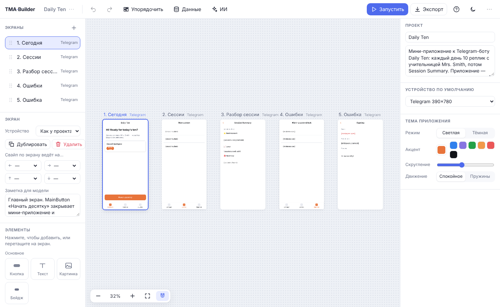
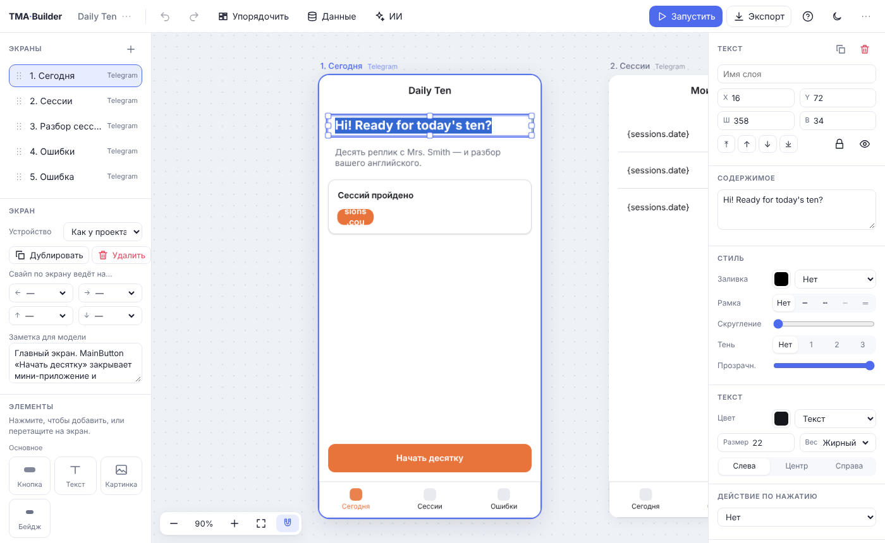
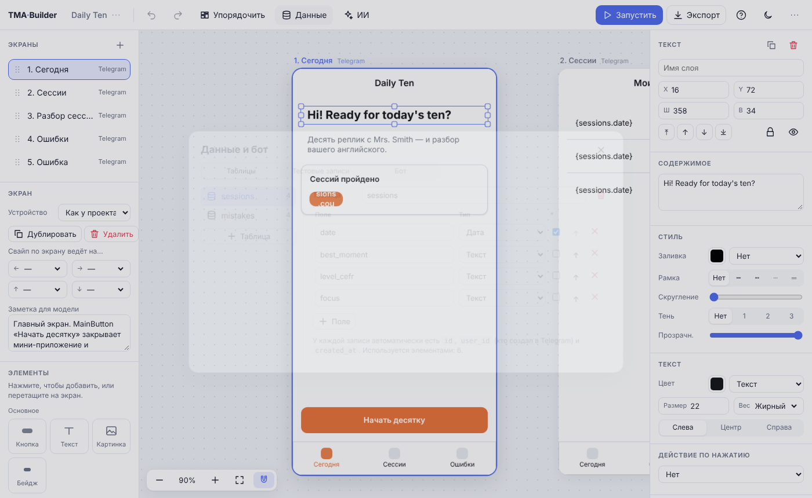
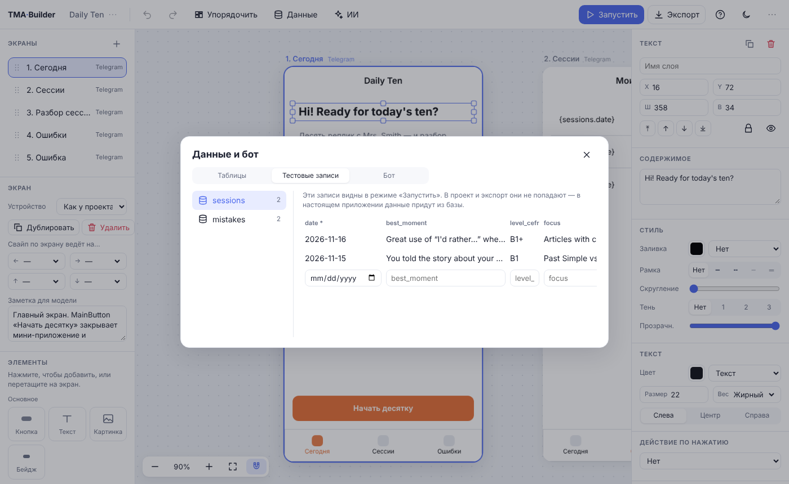
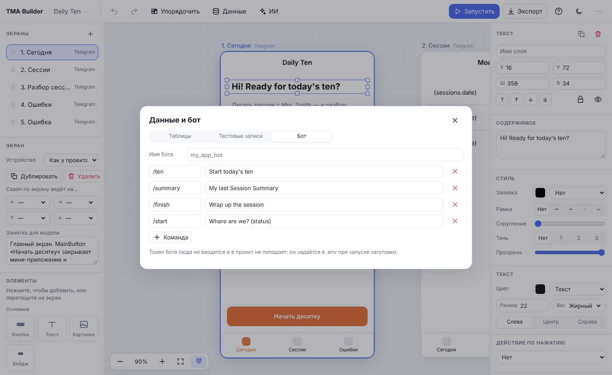
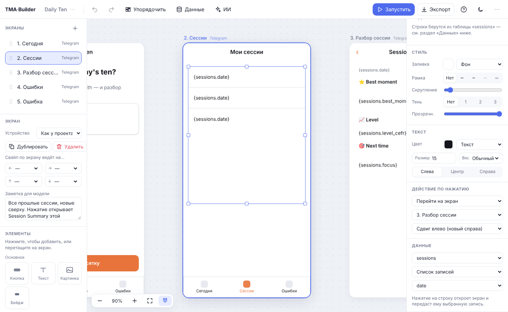
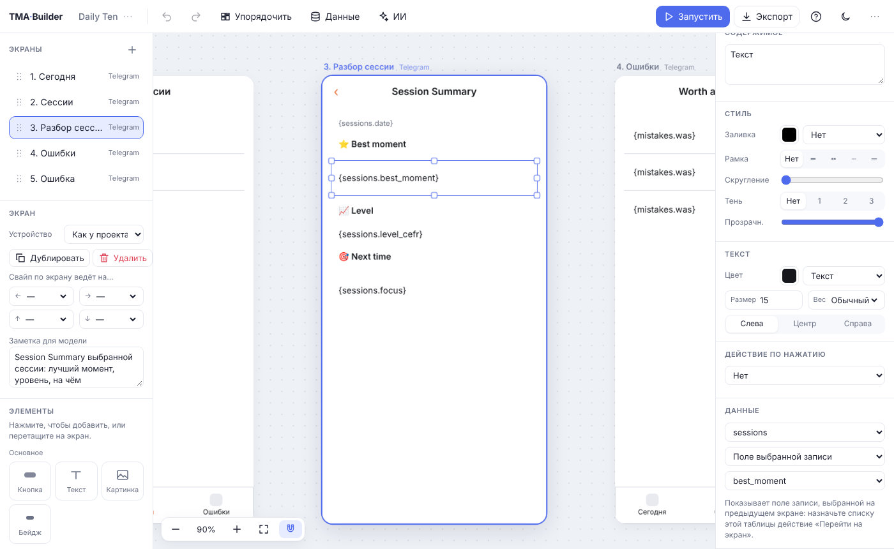
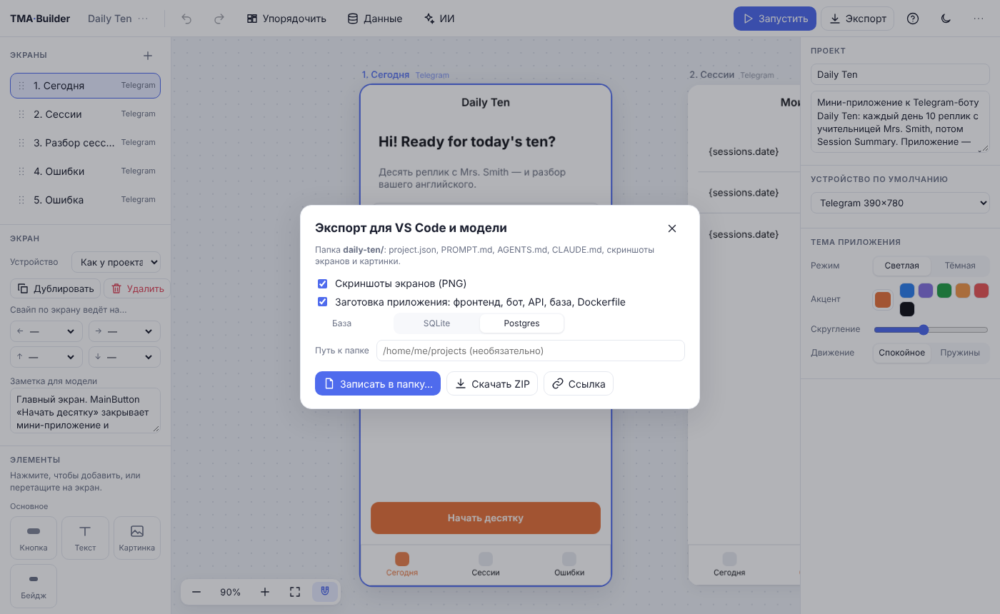

# Инструкция: мини-приложение к боту на примере Daily Ten

Эта инструкция проводит от пустого проекта до готовой папки для VS Code. Пример — мини-приложение к боту
[Daily Ten](https://github.com/inikonoff/Daily-Ten): каждый день бот ведёт разговор из десяти реплик с учительницей
Mrs. Smith и присылает Session Summary с разбором английского. Сам разговор остаётся в чате, а мини-приложение
становится **дневником прогресса**: сколько сессий пройдено, разбор каждой сессии и ошибки, которые стоит повторить.

Готовый результат можно открыть сразу: **название проекта вверху → «Новый» → «Пример: Daily Ten»**.
Инструкция объясняет, как собрать то же самое своими руками и что делать дальше с ботом.

## 1. Что такое мини-приложение и зачем оно боту

Telegram Mini App — это веб-страница, которая открывается внутри Telegram по кнопке бота. Бот хорош для разговора,
а мини-приложение — для того, что неудобно листать в чате: списки, карточки, история, настройки.

Для Daily Ten это значит: разговор и Summary приходят в чат, как и раньше, а в мини-приложении все прошлые сессии
и ошибки собраны в одном месте.

TMA Builder отвечает за первую половину работы: экраны, переходы, данные и проверку сценария. Вторая половина —
код, который подключает приложение к базе бота, — пишется по экспорту, удобнее всего вместе с Claude Code
(раздел 10).

## 2. Новый проект

Нажмите на название проекта в верхней панели и откройте вкладку **«Новый»**. Для своей работы выберите
«Пустой проект», для просмотра готового результата — «Пример: Daily Ten».


Справа в разделе **«Проект»** напишите название и пару фраз о приложении. Этот текст попадёт в описание
для нейросети при экспорте, поэтому пишите так, как объяснили бы задачу разработчику.

Там же выберите **устройство по умолчанию** — «Telegram 390×780» — и **тему приложения**. В примере светлая тема
с тёплым оранжевым акцентом `#e8743b`.

## 3. Экраны

В панели «Экраны» слева кнопкой **+** создайте пять экранов и переименуйте их двойным кликом:

1. **Сегодня** — главный экран: приветствие, сколько сессий пройдено, кнопка «Начать десятку».
2. **Сессии** — список прошлых сессий.
3. **Разбор сессии** — Session Summary выбранной сессии.
4. **Ошибки** — что стоит повторить.
5. **Ошибка** — объяснение одной ошибки.

Порядок меняется перетаскиванием за точки слева. В поле **«Заметка для модели»** под списком кратко опишите, что
происходит на экране, — это тоже уйдёт нейросети.



Управление холстом: **колесо мыши** — масштаб, **правая кнопка** — двигать холст, **Shift+1** — показать все экраны.

## 4. Главный экран

Элементы добавляются из палитры слева: **клик** ставит элемент под последним на активном экране,
**перетаскивание** — точно в нужное место.

На экран «Сегодня» добавьте:

- **Шапку** (раздел Telegram) — она сама встанет наверх во всю ширину. Текст: «Daily Ten».
- Два **текста**: крупный «Hi! Ready for today's ten?» и пояснение под ним.
- **Карточку** «Сессий пройдено» и **бейдж** внутри неё — в бейдже будет число сессий (раздел 6).
- **MainButton** «Начать десятку» — главную кнопку Telegram. Она встанет внизу экрана.
- **Навигацию** — нижнее меню из трёх пунктов: «Сегодня», «Сессии», «Ошибки».

Текст любой кнопки или надписи правится **двойным кликом прямо на холсте**: Enter — сохранить, Esc — отменить.



Элементы двигаются мышью и сами притягиваются к краям и центрам соседей (розовые направляющие). Ctrl при
перетаскивании отключает привязку. **«Упорядочить»** в верхней панели выравнивает экран по правилам: шапка
наверху, ровные отступы, навигация внизу. Повторное нажатие отменяет.

> MainButton в Telegram — нативная кнопка внизу окна. В Daily Ten она должна закрыть мини-приложение и отправить
> боту `/ten`. Запишите это в заметке экрана — модель увидит при экспорте.

## 5. Данные и бот

Откройте **«Данные»** в верхней панели. На вкладке **«Таблицы»** создайте две таблицы — это то, что мини-приложение
будет получать от бота:

| Таблица | Поля |
|---|---|
| `sessions` | `date` (дата, обязательное), `best_moment`, `level_cefr`, `focus` (текст) |
| `mistakes` | `was`, `correct` (текст, обязательные), `why`, `category` (текст) |

У каждой записи автоматически есть `id`, `user_id` (кто из Telegram её создал) и `created_at`.



На вкладке **«Тестовые записи»** заведите пару сессий и ошибок. Они нужны, чтобы проверить сценарий в режиме
«Запустить», и в проект не попадают: в настоящем приложении данные придут из базы бота.



На вкладке **«Бот»** перечислите команды бота. У Daily Ten это `/ten`, `/summary`, `/finish` и `/start`.
Токен бота здесь не вводится и в проект не попадает.



## 6. Список → разбор сессии

Это главный приём мини-приложений: список записей, а нажатие на строку открывает подробности.

**Экран «Сессии».** Добавьте **список**, выделите его и в инспекторе справа:

1. В разделе **«Данные»** выберите таблицу `sessions`, режим **«Список записей»**, поле `date` — в строках будут даты.
2. В разделе **«Действие по нажатию»** выберите **«Перейти на экран» → «Разбор сессии»**.

Подсказка под настройками подтверждает: *нажатие на строку откроет экран и передаст ему выбранную запись*.
На холсте привязанные значения выглядят как `{sessions.date}` — так видно, откуда они придут.



**Экран «Разбор сессии».** Добавьте шапку «Session Summary», кнопку **BackButton** (действие «Назад»), подписи
«⭐ Best moment», «📈 Level», «🎯 Next time» и под каждой — текст с привязкой **«Поле выбранной записи»**:
таблица `sessions` и поля `best_moment`, `level_cefr`, `focus`.



Экраны **«Ошибки»** и **«Ошибка»** собираются так же: список по таблице `mistakes` (поле `was`) с переходом на
«Ошибка», а там тексты с полями `was`, `correct`, `why`.

Бейдж на главном экране привяжите к `sessions` в режиме **«Одно значение»** без поля — он покажет число записей.

## 7. Нижнее меню

Выделите **навигацию** на экране «Сегодня». В разделе «Содержимое» у каждого пункта есть выбор экрана:
«Сессии» → экран «Сессии», «Ошибки» → экран «Ошибки». Пункт «Сегодня» оставьте без перехода — вы и так на нём.
Число в поле **«Активный»** — какой пункт подсвечен.


Скопируйте навигацию на экраны «Сессии» и «Ошибки» (Ctrl+C на одном экране, Ctrl+V на другом), поменяйте
активный пункт и ссылки. Пункты меню **заменяют** текущий экран, а не копятся в истории «Назад» — как в настоящих
приложениях.

Слева внизу **«Карта связей»** рисует все переходы стрелками. Удобно проверять, что ни один экран не остался
без входа.

## 8. Запустить

Нажмите **«Запустить»** (или клавишу P). Экран устройства встанет по центру, и приложение можно пройти как настоящее:

- нижнее меню переключает разделы;
- нажатие на сессию в списке открывает её разбор с данными этой сессии;
- «‹» в шапке и кнопка «Назад» над экраном возвращают обратно, переход проигрывается в обратную сторону;
- **«Зоны»** подсвечивают всё, что можно нажать; клик мимо подсвечивает зоны на полсекунды;
- список **«Тема проекта / Telegram светлая / Telegram тёмная»** показывает экраны в цветах Telegram.


Если что-то не так, нажмите «Стоп», поправьте и запустите снова. Отменить можно что угодно: Ctrl+Z.

Перед большими правками сохраните версию: **название проекта → «Версии» → «Сохранить версию»**. К ней можно
вернуться в любой момент.

## 9. Экспорт

Нажмите **«Экспорт»**. Отметьте:

- **Скриншоты экранов** — модель увидит, как задумано визуально;
- **Заготовка приложения** — если хотите готовый код фронтенда. База — **Postgres**: у Daily Ten Supabase.

Затем **«Записать в папку…»** (Chrome и Edge) или **«Скачать ZIP»**. Если указать путь к папке, после записи
появится ссылка «Открыть в VS Code».



В папке будут:

| Файл | Что это |
|---|---|
| `PROMPT.md` | Экраны, элементы, переходы, данные и тема словами — для модели |
| `AGENTS.md`, `CLAUDE.md` | Правила работы для Claude Code и других агентов |
| `project.json` | Исходный макет; открывается обратно в TMA Builder |
| `screens/*.png` | Скриншоты экранов |
| `app/` | Фронтенд: Vite + React + TypeScript + Telegram WebApp SDK |
| `server/` | Бот и API на TypeScript — универсальная заготовка, для Daily Ten не нужна (см. ниже) |

## 10. Подключение к боту Daily Ten

У Daily Ten уже есть свой бот на Python (aiogram) и своя база на Supabase, поэтому `server/` из заготовки ему не нужен.
Нужно три вещи: страница мини-приложения, API в существующем боте и кнопка, которая открывает приложение.

### Откуда берутся данные

Таблицы из раздела 5 — это **представление** данных бота, отдельных таблиц в базе создавать не нужно:

| В мини-приложении | В базе Daily Ten |
|---|---|
| `sessions.date` | `sessions.started_date` |
| `sessions.best_moment`, `level_cefr`, `focus` | поля JSON в `sessions.user_summary` (`focus` — список, склеить в строку) |
| `mistakes.was`, `correct`, `why` | `user_summary.mistakes[]` (`was`, `correct`, `why`) |
| `mistakes.category` | `error_logs.category` |

Брать нужно только завершённые сессии своего пользователя: `status = 'completed'`, `user_id` = id из `initData`.

### Что поручить Claude Code

Откройте в VS Code обе папки — экспорт и репозиторий Daily-Ten — и дайте Claude Code задачу примерно такую:

```text
Прочитай AGENTS.md и PROMPT.md в папке экспорта и посмотри screens/*.png.
Подключи мини-приложение к боту Daily-Ten:
1. В src/health_server.py (aiohttp) добавь GET /api/sessions, /api/sessions/{id} и /api/mistakes.
   Данные бери из sessions и user_summary по таблице соответствия из docs/GUIDE.md TMA Builder.
   Каждый запрос проверяет заголовок X-Telegram-Init-Data (HMAC-SHA256 от TELEGRAM_BOT_TOKEN),
   пользователь — только свои записи. CORS — только для адреса мини-приложения (новая переменная WEBAPP_URL).
2. В /start и в меню бота добавь кнопку WebApp, открывающую WEBAPP_URL.
3. Фронтенд из app/ настрой на этот API (VITE_API_URL), MainButton «Начать десятку» закрывает приложение
   и отправляет /ten. Сборку выложи на GitHub Pages.
Добавь тесты на проверку initData и на новые эндпоинты, обнови README и .env.example.
```

### Важно про безопасность

- Мини-приложение никогда не получает токен бота и строку подключения к базе — только `initData` от Telegram.
- Сервер проверяет подпись `initData` на **каждом** запросе. Без этого любой мог бы прочитать чужие сессии,
  подставив чужой `user_id`.
- Мини-приложение открывается только по HTTPS: GitHub Pages подходит, адрес нужно вписать в `WEBAPP_URL`
  и в @BotFather (Bot Settings → Menu Button).

## 11. Полезное

- **Кнопка «?»** в верхней панели снова запускает обучение по интерфейсу.
- **Меню «⋯»** — новый проект, открыть или сохранить JSON, версии, язык (русский / английский), горячие клавиши.
- **ИИ** в верхней панели собирает черновик экрана по описанию («список уроков с прогрессом»), предлагает схему данных
  и переписывает тексты. Результат — черновик: «Оставить» или «Отменить». Нужен ключ Groq.
- **Ссылка** в окне экспорта упаковывает проект в адрес — удобно отправить себе на другой компьютер
  (картинки, загруженные с диска, в ссылку не входят).
- Все проекты хранятся в этом браузере. Для надёжности время от времени сохраняйте JSON: меню «⋯» → «Сохранить JSON».
